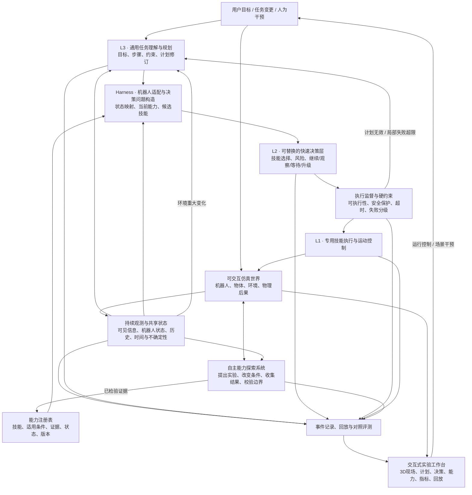

# Cross-Embodiment Decision Lab
## 跨机器人自主能力发现与分层决策实验平台 · 产品需求文档（PRD）

| 文档属性 | 内容 |
|---|---|
| 版本 | **V1.2 — 研究闭环优先与工程交付修订版** |
| 日期 | 2026-11-16 |
| 状态 | **按项目负责人决定修订交付顺序，01 物理基础进入收尾** |
| 产品类型 | 面向个人研究、实验与技术展示的具身智能仿真平台 |
| 目标环境 | 本地电脑优先，纯仿真；不采购、不连接实体机器人 |
| 产品负责人 | 项目发起者 |
| 文档用途 | 统一最终产品定义、系统职责边界、功能需求、体验质量与验收口径；供后续Agent据此独立形成技术设计方案 |
| 参考项目 | [STEERIX-home/robo-jev](https://github.com/STEERIX-home/robo-jev)（**设计参考，非本项目基础仓库或强制依赖**） |

> **文档原则：** 本PRD必须完整定义“产品是什么、整体系统如何协作、用户能看到什么、什么结果算完成”，但不提前规定“用哪种框架、算法、网络协议、目录结构或具体代码实现”。技术方案由后续独立的技术设计文档决定，并逐条映射本PRD。

---

# 1. 执行摘要

## 1.1 一句话定义

构建一个**真实运行、可交互、可观察、可复现实验的机器人仿真平台**：机器人能接受自然语言任务，在共享的分层智能系统中执行任务；新机器人可通过自主探索建立有证据的能力模型，再经统一Harness适配共享规划与快速决策机制；环境变化时，系统能局部恢复、必要时重新规划，并通过对照实验判断这些机制是否真正有效。

## 1.2 为什么要做

我们关心的问题不是让机器人播放一段成功动画，而是：

- **通用智能与机器人身体能否解耦？** 不同形态的机器人是否能够复用部分规划与判断能力，而不只是复用一个API名字？
- **机器人能否探索自己的能力边界？** 一项技能在什么条件下可用、成功率如何、什么情况下会失败，应当由仿真实验而不是模型自述决定。
- **快速判断层是否值得存在？** 在动作选择、风险判断和异常升级方面，能否以可接受的延迟/成本带来可验证的收益？
- **系统能否真正闭环？** 观察、规划、决定、执行、验证、异常恢复和重新规划必须围绕同一个动态世界持续发生。
- **能否把复杂系统解释清楚？** 任何一次行动应能追溯为“观察到了什么、有哪些选项、为什么选择、实际发生了什么”。

## 1.3 核心产品主张

**共享决策，不假装共享身体；先探索并验证能力，再把能力用于决策；让物理后果而非模型文字决定结果；把异常恢复和实验评测作为产品的第一类能力。**

## 1.4 目标用户

1. **研究/开发操作者**：配置机器人、任务、扰动、决策策略；调试并复盘系统行为。
2. **技术评审者**：用少量操作就能理解系统核心机制、观察关键行为，并查看支撑结论的实验证据。
3. **后续协作者**：依据需求、运行记录与功能边界复现、扩展项目，降低对单一作者或Agent的依赖。

---

# 2. 最终产品形态与总体架构

## 2.1 一张图看懂完整系统

下图描述**产品逻辑架构和信息流**，不限制实际进程、类、服务、线程或部署结构。

**必须理解的两条闭环：**

- **在线任务闭环**：世界 → 持续观测 → L3计划 → Harness → L2判断 → 执行监督 → L1动作 → 世界；每次动作结果更新下一轮决策。
- **能力学习闭环**：已有控制能力 → 探索实验 → 世界反馈/结果核验 → 能力表更新 → Harness使用新能力；探索不是每次在线行动都必须执行的操作。

**必要的反馈支路：** L2或执行监督器发现现有计划不再成立时，携带当前状态、失败历史、剩余目标回到L3；紧急停止不得等待L3响应。

## 2.2 模块责任、输入输出和不负责的内容

| 逻辑模块 | 必须负责 | 获取的信息/提供的结果 | **不应负责** |
|---|---|---|---|
| 仿真世界 | 维护物体、机器人、环境与物理后果；响应交互扰动 | 接受动作与实验设置；产生状态与物理结果 | 给AI偷偷提供正确行动答案 |
| 感知与状态层 | 对观测进行统一表达，保留来源、时间与不确定性；持续更新任务环境状态 | 来自传感/仿真观测的可见信息；输出可用状态 | 将仿真隐藏真值无标记地当作机器人“看见” |
| **L3任务规划** | 理解目标、生成步骤与约束；在条件改变时修订计划 | 目标、共享状态、能力摘要与执行历史；输出计划/修订 | 以高频方式直接操纵关节、代替基础控制器 |
| **能力注册表** | 管理技能描述、适用条件、证据、验证状态及版本 | 探索与执行结果；提供可追溯的能力记录 | 根据LLM口头推测自动宣布“已验证” |
| **Harness适配层** | 映射不同机器人能力和观测为统一决策语义；根据当前计划生成候选技能 | 状态、计划、能力表；输出候选行动及条件 | 通过私藏答案或过度筛选使L2比较失去意义 |
| **L2快速决策** | 对候选行动与局部状态作出快速判断；识别需要观察/等待/升级的条件 | 标准化决策问题；输出选择/评分/不确定性/升级建议 | 生成不可验证的任意底层运动命令；绕过约束 |
| **执行监督/约束** | 检验动作可执行性；处理停机、重试预算、超时、冲突和升级 | L2建议与执行状态；输出执行许可、拒绝、暂停、升级 | 将模型风险分数当成安全认证 |
| **L1专用执行** | 使用当前机器人的可用控制技能；反馈实际执行状态 | 执行许可与技能参数；输出动作过程和真实结果 | 伪造成功、擅自改写L3目标 |
| **自主探索系统** | 提出试验、管理探索预算、改变实验条件、估计能力边界 | 当前基础控制能力、实验历史及仿真反馈；输出候选能力与证据 | 假设“测试没成功=物理上永远不可能” |
| **记录、评测与回放** | 保留同条件实验、事件及指标证据；生成对照与复盘 | 各模块事件、版本与仿真结果；输出可复核报告 | 只记录成功片段或推断未测量的指标 |
| **交互工作台** | 让行为、因果链、模型差异和实验结果直观可见 | 实时/历史状态与结果；提供交互操控 | 用固定演出替代真正的运行过程 |

## 2.3 共享与专用边界

**期望跨机器人复用的部分**：任务语义、L3规划能力、L2决策接口与策略、异常升级原则、能力记录规则、实验与可视化机制。

**允许机器人专用的部分**：传感信息映射、基础执行技能、动力学/物理参数、控制器、能力表内容、硬约束与特定任务的适配内容。

不得要求不同机器人拥有完全相同的动作集合。共享的是**决策语义和流程**，不是默认可迁移的运动能力。若新机器人需要修改共享逻辑，必须记录修改原因，不能把这种修改隐瞒为“零适配”。

## 2.4 统一概念实体（产品语义，不是代码数据结构）

- **Robot Profile**：机器人身份、形态、基础可控制能力、感知来源与限制。
- **World Observation**：时间戳、可见对象、状态、置信/不确定信息、历史观测及来源标记。
- **Task / Plan**：用户目标、约束、成功条件、步骤、当前阶段、计划版本与完成历史。
- **Skill / Capability Record**：能力名称、前置条件、参数范围、执行结果定义、验证证据、来源、版本与有效状态。
- **Decision Request**：当前情境、所处计划步骤、候选行动、已知限制、需回答的决策问题。
- **Decision Result**：建议行动、相应评分/概率（如模型支持）、不确定性与升级建议、所用策略版本。
- **Execution Result**：真实动作结果、事件、失败原因、耗时及下一状态。
- **Experiment Run**：机器人、场景、任务、策略、能力表版本、种子、扰动、记录、评测结果与资源消耗。

这些实体间的语义必须稳定、可追溯。**具体采用何种格式、存储或通信协议由技术方案决定。**

---

# 3. 典型完整体验与场景叙事

产品最终应让评审者看到的不仅是“机器人动起来”，而是**一个有明确任务、发生真实变化、做出可观察判断、面对失败并采取后续行动的动态过程**。

## 3.1 主场景A：动态桌面操作工作站

**环境**：一台带抓取能力的机械臂、具有质量与碰撞属性的多个物体、目标区域、局部障碍物、完整可见的工作台与物理空间。

**用户目标**：例如“将指定物体放入目标区域，避免碰到禁触物体”。

**预期体验**：

1. 用户以自然语言发出任务，界面展示L3对目标的理解与步骤。
2. 机器人在世界中执行接近、抓取、搬运和放置；物体与夹爪有真实可辨的接触和运动后果。
3. 用户在任务执行中移动目标物体、改变障碍位置或使一次抓取不再满足条件。
4. 界面同步呈现观测变化、L2选择、被拒绝的动作、局部恢复或上报L3的过程。
5. 系统根据执行后的实际状态确认任务完成、失败或无法继续，而非直接相信模型宣称。
6. 用户切换决策策略，在相同条件下再次运行并观察差异，随后查看结果对比和事件回放。

**要求**：所有关键变化应来自真实运行中的状态与物理过程；不允许只有文字日志变化、机器人动画却始终按照预设路径行进。

## 3.2 主场景B：不同形态机器人的动态移动/交互任务

**环境**：一台与机械臂能力和运动结构明显不同的机器人，具有独立的基础技能和可交互的动态环境；例如搬运通道、移动障碍、可变通行条件。

**用户目标**：例如“将货物送至目标点，遇到障碍与通道变化时安全作出决定”。

**预期体验**：

1. 使用同一个产品工作台切换到第二类机器人。
2. 查看其专属能力表与自主探索记录；观察系统保留了哪些共享规划/决策机制。
3. 机器人在环境中行动，遇到突发的通道阻碍、移动物体或任务约束变化。
4. L2选择等待、绕行、重新观察、选择其他可用技能，或在超出当前计划能力时升级L3。
5. 用户对比该机器人与前一机器人对**共通决策问题**的判断方式，并查看专用适配内容。

**要求**：不是机械臂换一套皮肤。第二类机器人必须有真正不同的技能、约束、动作表现和运行反馈；两个场景必须同样具备独立、可运行的体验价值。

## 3.3 探索体验：陌生机器人认识自己的能力

用户选择一台机器人及一项候选能力，配置探索预算。系统展示：探索目标 → 下一次要测试的条件 → 在仿真中的真实尝试 → 成功或失败 → 能力边界估计更新 → 带证据的能力表。用户应能主动检查某个“已验证能力”是由哪些实验支持，而不只是看到一张自动生成的技能列表。

## 3.4 演示应具有的可感知“高完成度”

- **连续的3D物理行为**：角色、物体、障碍与动作有可信的空间关系、接触状态和运动反馈。
- **真实可干预性**：用户的现场干预会改变结果，同一任务允许出现不同运行轨迹、局部失败和恢复。
- **一眼可读的智能决策**：旁观者能在正确时机看到“做了什么判断、依据是什么、后来发生什么”，而不是埋在海量控制日志里。
- **场景级完整叙事**：每个主场景能从任务开始持续运行到完成/失败/恢复，有清晰事件起伏，而不是仅一个孤立的夹方块动作。
- **可比较的策略行为**：至少能用同条件对照或并排回放直观呈现不同决策方案的差异。
- **专业的视觉与交互呈现**：有清楚的视觉层级、良好的灯光/材质/相机视角与统一交互；画面不依赖浮夸装饰掩盖功能不足。

最终作品优先追求**场景质量、动态行为复杂度、完整交互与因果解释**。阶段 01—06 先形成物理任务、决策闭环、能力探索和可复现实验，开发观察使用原生仿真查看器、CLI、结构化记录与静态报告。集成式浏览器 playground 在阶段 07 接入已验证的实验核心与实际结果。

---

# 4. 主要用户流程与系统状态规则

## 4.1 首次接入机器人

选择机器人 → 加载可用基础控制能力与观测说明 → 建立机器人档案 → 使用已存在的能力记录或进行探索 → 标记能力验证状态 → 进入任务工作台。

没有经验证的能力，也可以在明确标为**人工声明/实验候选**的条件下进行受控测试，但不能当作已证明可靠的能力使用。

## 4.2 正常任务闭环

用户提出目标 → L3解释目标并产出计划 → 状态层持续观测 → Harness读取计划及对应机器人能力、构建候选 → L2作局部判断 → 执行监督校验 → L1动作 → 仿真世界真实演化 → 状态及任务进度更新 → 下一轮判断 / 完成 / 失败。

**L3并非每次L2决策都必须调用；L2也不是所有底层运动细节的主控者。** L3负责跨步骤目标，L2负责局部行动取舍，L1负责完成动作。

## 4.3 异常与重新规划

| 事件 | 优先处理 | 产品必须表现的行为 |
|---|---|---|
| 目标小幅移动、局部障碍变化 | L2/局部技能 | 更新状态，选择继续、调整或重新观察；尽量不重做整个计划 |
| 单次技能失败但存在其他可行技能 | L2/执行监督 | 记录失败，按预算尝试可解释的替代或重试 |
| 长时间停滞、多次失败、能力表与现实不符 | 执行监督 + L2 | 停止无效循环；重新观察、撤销不可靠能力或升级L3 |
| 目标被移走、用户修改目标、计划前提失效 | L3 | 携带最新状态与完成历史，仅修订未完成部分 |
| 触发越界、紧急障碍、执行器异常 | 执行监督/L1 | 先暂停或安全中止，再处理诊断与后续规划 |
| 模型不可用、超时、返回非法候选 | 决策监督 | 按清晰的回退策略暂停/执行预先允许的安全动作/请求上层，不得无声替换结果 |

**升级保护**：每次重规划必须有触发原因和版本；应限制同一失败原因下的反复升级与反复重试；必须提供可终止状态。

## 4.4 自主能力探索与能力表更新

提出候选能力 → 定义能验证的结果及条件变量 → 选择探索实验 → 执行并采集真实结果 → 对同类条件重复验证 → 记录覆盖范围和不确定性 → 更新能力状态 → 提供给Harness使用。

**能力发现不等于无中生有地学习关节控制**。初始机器人应有可调用的基础动作或控制入口；如果要学习新运动技能，必须作为单独可审查的技术任务，并遵守本产品的能力验证规则。

## 4.5 研究与对照实验

选择场景/任务/机器人 → 固定初始条件、扰动和已有技能 → 选择规则或AI决策方案 → 执行多个可复现试次 → 汇总任务结果/行为/耗时/调用记录 → 对比成功与失败 → 导出可复核报告。

不能仅用不同方案的一次成功演出作为研究结论；也不能把Harness替模型完成的筛选结果归功于模型。

---

# 5. 功能需求（带验收标准）

**优先级约定**：P0 = 物理任务、单机器人闭环、基本观察控制、记录与基础对照；P1 = 自主探索、跨机器人、研究评测及最终集成展示；P2 = 深化实验或体验增强。P1 属于完整愿景的交付范围。完整浏览器 playground 对应实施文档 07，阶段 01—06 通过原生查看器、CLI 和文件报告验收。

## 5.1 三维仿真与真实交互

**FR-001｜持续运行的三维物理世界（P0）**：展示机器人、目标、其他物体、可触碰障碍和任务空间。物体运动、接触和结果应由物理模拟而非预设胜利动画产生。**验收**：改变初始位置、质量/摩擦等已支持条件或加入障碍，会实际影响运动结果；不成功时可见真实失败。

**FR-002｜可执行的完整任务（P0）**：首个主场景包含任务发起、接近、操作、运输/移动、完成判定、失败处理。**验收**：能从同一入口完整运行至终态，不依靠人工手动伪造成功。

**FR-003｜实时干预与任务变更（P0）**：用户可以暂停、继续、重置、调整目标或触发至少三种互相独立的扰动。**验收**：扰动时机、类型和后果在 CLI/原生反馈与日志中可追溯，阶段 07 由同一记录接入界面。

**FR-004｜场景配置与复位（P0）**：可选择任务变体、机器人、初始参数和随机种子。**验收**：相同条件复位一致；外部模型不确定性在可复现报告里明确披露。

**FR-005｜多场景管理（P1）**：至少形成两个具有不同物理动作特征和任务叙事的高完成度主场景；支持快速切换和复用实验流程。**验收**：切换后共有交互与评测操作无需重新学习，机器人能力及约束按当前对象正确切换。

## 5.2 任务规划与共享状态

**FR-006｜自然语言任务入口（P0）**：输入任务并展示系统理解的目标、对象、成功条件与不可违反的约束。**验收**：不完整或无法实现的任务明确说明，不能凭空声明能力。

**FR-007｜L3可见计划（P0）**：计划可追踪、含步骤状态、约束、版本、历史与当前步骤。**验收**：任务执行时计划进度实际更新，任务改变时显示修订理由和差异。

**FR-008｜连续观测与状态可信性（P0）**：系统维护当前环境、机器人状态、观测时间、未知与过期信息。**验收**：对象遮挡、观测落后或数据缺失时，不能无标记暴露仿真隐藏真值给L3/L2。

**FR-009｜计划有效性与按需重规划（P0）**：系统能够识别原计划前提失效并将异常升级L3。**验收**：用户改任务、目标不可达与可局部恢复扰动分别出现合理行为；升级时携带未完成步骤和失败历史。

## 5.3 Harness与能力系统

**FR-010｜统一机器人档案（P0）**：描述机器人形态、已接入基础技能、观察能力和约束。**验收**：清楚区分各机器人专有信息与系统共有概念。

**FR-011｜有证据的能力记录（P0手工声明；P1自主更新）**：每项能力包含用途、前置条件、验证范围、执行结果标准、来源、状态、版本、样本及失败证据（如已测试）。**验收**：模型写出的文字不能直接升级为“已验证”；未知条件保留未知状态。

**FR-012｜Harness统一决策问题（P0）**：根据计划、当前观测与当前机器人的可用能力生成候选技能及其语义。**验收**：L2不依赖某一机器人专有动作词才能运行；无候选时返回明确原因。

**FR-013｜能力与前置条件审核（P0）**：系统需识别已知越界、缺失技能或条件不满足。**验收**：显然不可执行的动作被拒绝并记录依据；对于未知条件不得伪称已通过验证。

**FR-014｜能力表生命周期（P1）**：支持候选、待验证、验证中、已验证、受限、失效、需复核等状态及版本对比。**验收**：新的失败证据可以限制、撤回或要求复核旧能力，而不是永久固定成功标签。

## 5.4 快速判断、执行与异常

**FR-015｜可替换L2决策策略（P0）**：在固定输入含义下支持规则方案和至少一种模型驱动方案，后续支持快速判断和按需升级方案。**验收**：替换策略不要求同时改写L1控制行为或任务定义。

**FR-016｜局部行动与风险判断（P0）**：L2可建议继续、等待、重新观察、切换候选技能或上报L3；若可获得概率/评分，应连同所选项一起记录。**验收**：候选、选择、延迟、版本、执行后果可逐步查看；评分不是执行许可。

**FR-017｜动作执行与真实反馈（P0）**：L1根据获准的技能发起执行，产生成功、失败、中断、超时及必要的进度反馈。**验收**：模型输出“成功”而物理任务未成功时，最终结果必须按物理验证记录。

**FR-018｜执行监督与安全中止（P0）**：检查基本硬约束、重复/冲突命令、超时、重试预算和危险状态。**验收**：危险或非法动作被拒绝，系统可以有序暂停/退出；不声称满足真机安全认证。

**FR-019｜异常分级和恢复闭环（P0）**：区分局部恢复、任务重规划和紧急安全保护。**验收**：至少三种干扰可分别触发可解释的恢复或终止路径；无无限循环。

**FR-020｜同一错误的升级节流（P0）**：持续失败时需要停止盲目尝试，显示触发原因及后续处理。**验收**：重复失败、重复重规划和决策超时均有限制与可观察的最终状态。

## 5.5 自主探索与能力发现

**FR-021｜探索任务生成（P1）**：对给定候选能力生成可执行、可衡量的物理实验；探索范围从已有基础控制接口开始。**验收**：每次尝试有明确要验证的条件和成功标准。

**FR-022｜条件变化与主动探索（P1）**：改变与能力相关的测试变量，并根据此前结果决定进一步测试哪些条件；支持预算、暂停、中止与继续。**验收**：能够与随机或固定扫描方式做同预算对照。

**FR-023｜能力边界估计（P1）**：通过重复试验记录成功频次、测试条件、观测到的失败原因与未覆盖范围。**验收**：不能用单次失败宣告机器人永久不能完成任务；能在未用于建表的条件上检验能力表。

**FR-024｜探索结果进入在线决策（P1）**：已验证能力可供Harness使用；能力失效或验证不足时影响候选状态。**验收**：相同任务在能力更新前后可观察到合理候选变化，且有版本和实验依据。

## 5.6 跨机器人复用

**FR-025｜第二形态机器人（P1）**：接入与首个机械臂存在明确身体、执行技能和环境交互差异的机器人。**验收**：其独立动作与条件约束真正生效，而非共用一套预录动作。

**FR-026｜共享规划与判断能力（P1）**：替换机器人专有适配与执行部件，尽可能保留L3/L2的公共流程及核心策略。**验收**：形成“共享部分/新增部分/修改部分”清单，并对每项修改说明原因。

**FR-027｜可比较的跨形态决策问题（P1）**：至少选择一组在两种机器人中都有意义的决策问题，例如等待/继续、重新观察、局部恢复/升级。**验收**：评测区分“共同决策能力”和“不同控制器的本体性能”。

## 5.7 实验工作台、回放和展示

**FR-028｜集成式3D实验工作台（P1，阶段07）**：基于已经运行的实验核心接入场景视窗、运行/暂停/重置、任务入口、计划、决策、动作和异常。**验收**：通过同一命令入口操作真实运行，能查询实际实验记录并解释结果。阶段 01—06 的控制入口为 CLI 或原生查看器。

**FR-029｜决策可观察性与可视化（P0结构化解释；P1浏览器呈现）**：P0 保存并能检索候选、选择、拒绝依据、观测年龄、延迟和后果，CLI 或报告可按事件定位。阶段 07 将同一证据呈现为决策详情和视觉聚焦。**验收**：同一决策在原始记录、报告和最终界面中语义一致。

**FR-030｜完整事件时间线（P0）**：记录观测、任务步骤、能力、模型、执行、安全门控、异常与升级。**验收**：通过运行身份、时间与关联标识定位一次失败及后续响应，记录在 CLI 中可检索，后续界面读取同一时间线。

**FR-031｜可回放的实验（P0记录与重建；P1交互复盘）**：早期保留配置、模型身份、状态快照、事件和完整性信息，支持按时间或事件重建关键状态。阶段 07 接入播放与时间轴。**验收**：成功和失败片段均来源于实际记录，历史格式有兼容读取或明确迁移方法，重执行另行记录环境与随机性。

**FR-032｜对照实验体验（P0命令与报告；P1浏览器比较）**：先以 CLI 在相同条件运行不同策略并导出差异事件和指标，阶段 07 增加交互比较。**验收**：报告和界面引用同一结果来源，benchmark 统计可独立重建。

**FR-033｜场景级展示流程（P1，阶段05形成运行路径，阶段07集成）**：两个场景分别具备典型任务、动态变化和完整恢复或失败路径。**验收**：早期用命令与原生查看器复现，最终评审者依据工作台指引自主操作。

**FR-034｜专业交互与视觉品质（P0调试可读；P1阶段07完整体验）**：早期保证机器人、物体、接触、状态和控制反馈清晰；阶段 07 完善灯光、材质、镜头、布局与交互。**验收**：按第 7 章评价最终产品，同时单独验收物理与评测一致性。

## 5.8 数据与研究评测

**FR-035｜实验身份与可复现配置（P0）**：记录机器人、任务、场景、策略、能力表版本、模型配置、初始状态、随机种子、扰动和运行时环境。**验收**：能重建同条件试验；无法复现的因素明确披露。

**FR-036｜基础策略与同条件比较（P0）**：至少规则基线与模型驱动方案在相同机器人、技能集和任务条件下比较。**验收**：不允许把不同控制器或场景难度的差异冒充决策效果。

**FR-037｜核心评价指标（P0）**：记录成功/失败率、任务耗时、决策延迟、异常恢复、停止和拒绝、L3重新规划、模型成本（可获取时）、无法完成原因。**验收**：指标口径一致；缺失值标记为未知，不写成0。

**FR-038｜防止信息泄露和虚假增益（P0）**：严格区分给模型的观测与仿真内部用于判定结果的真值；对候选项预筛选的贡献进行说明。**验收**：评测方案能识别Harness替模型预先解决问题的情况，不能拿隐藏真值作弊。

**FR-039｜未见场景与失败案例（P1）**：保留未经调参使用的任务/扰动或物理条件，测试泛化并展示失败样本。**验收**：报告不只呈现开发过程反复优化过的演示任务。

**FR-040｜可导出的研究报告（P1）**：报告包含实验目的、配置、方案差异、结果、失败分析、结论适用范围与局限。**验收**：无论AI是否优于规则，均如实呈现。

---

# 6. 信息可信性与产品行为约束

## 6.1 观察信息与隐藏真值必须分开

同一仿真场景至少区分两种信息：

- **机器人可用观测**：当前真的可见/可测到的信息，包括观测时间、误差、遮挡、未知项。
- **实验核验信息**：仿真引擎内部可用于标注碰撞、质量、真实位置、任务结果的完整状态。

后者允许用于评测和能力验证，但未经明确标记与授权，不能直接进入在线决策模型输入。若M1为了验证闭环需要较简化的感知替代方案，必须在 CLI/配置与报告中说明，阶段 07 同步呈现；后续可以替换更真实的感知方式而不改变整个决策语义。

## 6.2 能力表中的“成功率”是条件性结果

例如“在已测试质量范围、特定夹爪配置和特定物体条件下成功86/100次”，不同于“这台机器人抓取成功率是86%”。能力记录必须保存测试条件、样本量、版本、失败原因和未知边界。

## 6.3 决策模型不拥有最终执行权

L2建议必须经过执行监督；关键停止、越界和超时由可靠机制兜底。不得出现模型输出高概率就直接跳过硬性校验的流程。

## 6.4 探索与运行必须可区分

探索阶段可以为了发现边界而在受控、可复位的仿真中测试失败；正式执行阶段优先使用已知适用条件下的能力，并对试探性使用进行显式标记。两类事件、指标和能力更新均应可区分。

## 6.5 不夸大研究结论

“两个机器人共用接口”不等于“机器人能力已经零样本迁移”；“模型在自家仿真中表现优异”不等于“真实机器人可靠”；“能完成一次任务”不等于“具备可泛化技能”。

---

# 7. 最终交互与视觉品质要求

**最终产品包含集成式3D实验工作台，开发顺序采用研究闭环与评测证据优先。** 完整 playground 在阶段 07 实现，阶段 01—06 以原生查看器、CLI、事件检查和静态报告提供观察与操作。

### Playground 接入条件

进入阶段 07 时，先核对以下已有证据。

1. 单机器人完整任务、规则基线、模型策略和异常路径能从同一核心入口运行，已有可复现配置及真实成功、失败记录。
2. 文档 06 的 F01、F02、F07 已有实际执行结果，主对照的输入、指标、样本量、失败口径和局限可追溯。研究价值以可核验的问题与结果体现，效果方向由数据决定。
3. 生效配置、运行身份、状态、事件、终态、指标与记录格式均有版本化定义，字段明确单位、时间和来源。
4. 存量记录可供读取，报告可从原始数据重建，benchmark 核心具备独立于浏览器的运行与验证入口。

接入时由实验核心持有物理状态、任务状态、成功判定和指标，界面提交命令并读取回执与结果。增加 G04 一致性验收，检查存量数据读取、指标重建、命令链路和接入前后的回归。阶段完成情况和依赖缺口使用事实记录。

## 7.1 主界面信息层级

1. **主视觉区域**：持续可操作的3D场景应占据视觉重心，清晰展示机器人姿态、物体运动、空间关系和动态干预。
2. **任务与运行操作**：目标、场景/机器人切换、运行状态、暂停/重置、任务变更始终容易找到。
3. **当前智能行为**：恰当展示L3当前步骤、L2最新判断、当前执行技能及其结果，避免信息堆砌遮挡场景。
4. **能力与研究入口**：能力表、探索实验、策略选择、关键指标、事件时间线和历史回放可按需要展开。
5. **异常反馈**：危险停止、模型超时、动作失败、重新规划要清楚、及时、可追溯，不能悄悄消失。

**布局要求**：优先桌面端，保持信息密度与清晰视觉层级；不依赖层层嵌套卡片、过度装饰或大量弹窗。状态文本与3D画面必须同步，避免前端只是“假直播”。

## 7.2 3D体验基线

- 具备专业、完整、统一的环境构图，机器人与关键物体的比例、空间关系、材质和照明自然可信。
- 用户能够流畅观察整体任务，并在必要时查看动作发生的局部细节；镜头/聚焦应服务于理解行为，而非制造视觉噱头。
- 运动与接触反馈连贯；抓取、推动、掉落、碰撞、等待、避障等事件必须与仿真状态一致。
- 支持直接或明确可发现的方式干预场景，且场景会对干预作出有物理依据的响应。
- 同一个场景存在正常完成、局部失败和异常恢复等不同路径，而不只是固定成功剧本。
- 与3D内容叠加的信息应精简、可读、可关闭；关键动作不应被控制面板遮挡。
- 场景应有足以承载研究问题的环境细节，但**不为追求资产数量牺牲交互帧率、物理稳定性和可验证性**。

## 7.3 使用与展示体验验收

评审者应当能在**不打开源码、不依赖作者口头解说**的情况下完成以下完整体验：

1. 打开产品，理解当前场景和机器人能做什么。
2. 选择一个准备好的有意义任务，看到机器人在3D世界中完整执行。
3. 在关键时刻制造环境变化，看到机器人策略实际改变、恢复或失败。
4. 点开某次判断，了解候选动作、选中动作、执行约束和后果。
5. 切换另一个决策方案，观察相同条件下的差异。
6. 查看可信的事件回放及指标，而不是只得到一张成功截图。
7. 在最终版本中切换机器人或打开能力发现实验，看到共享智能与机器人专用能力的区别。

任何演示路径如果需要事先人工修改日志、操纵结果或隐藏失败，均不视为合格产品体验。

## 7.4 性能与稳定性体验目标

- 在项目声明支持的本地目标环境下，主场景应达到可连续观察与流畅交互的体验；技术方案须提供实测帧率、物理步进、模型响应与资源占用数据，不得仅写“理论可行”。
- 模型推理变慢时，3D视窗不应无提示地卡死；需要展示正在等待、超时或已进入安全暂停。
- 初始化、场景切换、任务重置、实验导出均需提供明确反馈；失败状态应可恢复到可用入口。
- 阶段 01—06 的默认原生视图应清楚显示真实任务与失败；阶段 07 集中完成最终 playground 的视觉与交互，并在声明支持的本地环境实测。
- **视觉品质与科学可信性同时验收，二者不得互相替代。**

---

# 8. 低耦合、代码质量与可维护性的产品级约束

本章描述**交付质量要求**，不指定具体软件架构模式、文件目录、类名或框架。技术设计者应自行选择最简实现，但必须提供下面的验证依据。

## 8.1 模块边界与可替换性

- **机器人替换不应牵连全部系统**：新增机器人应主要改变专用能力、约束和执行适配；如果必须修改共享规划/决策核心，应有明确理由与变更记录。
- **决策模型可替换**：规则、快速判断模型或通用模型在相同决策语义下可交换；替换不得改写实验定义或模拟世界核心行为。
- **感知可演进**：从受控状态输入到含噪声/遮挡的观察升级，不应使计划、能力表、评分与回放整体推倒重来。
- **探索系统与在线执行解耦**：不启用自主探索时，已配置的机器人仍应能执行任务；能力表更新不要求重建整个决策核心。
- **UI与实验核心解耦**：无人值守实验与批量评测应可独立运行；界面负责交互和呈现，不能持有决定实验正确性的唯一逻辑。
- **评测与被评测对象隔离**：评价标准不受当前策略修改；基线不能被同一处代码更改悄悄影响。

## 8.2 简洁、可读、可维护

- 优先使用成熟、可信的机器人模型、仿真组件和基础控制能力，不重复研发无关基础设施。
- 不为了“未来可能支持任意机器人”提前搭建臃肿抽象层；接口由至少两个具体接入实例反向验证其必要性。
- 不允许单一庞大模块同时掌管仿真、模型调用、计划、能力库、UI和日志；各主要职责需要清晰边界。
- 对同一种业务状态和实验结果只保留权威来源，避免多套互不一致的状态副本。
- 逻辑应该可解释，可由项目负责人根据设计文档理解模块职责、输入输出、主要异常与验证方式。
- 避免无用的中间适配、重复包装、永久残留的临时代码和为演示单独开设的隐藏成功通道。
- 依赖、运行方式、可配置选项、已知限制需有准确文档；遵守引用开源资产的许可与署名。

## 8.3 强制可验证质量门槛

1. **替换测试**：至少更换一套决策策略，不修改仿真任务和L1基础执行语义。
2. **新机器人接入测试**：记录引入第二机器人时需要修改的范围，检查共享层是否被迫写满机器人专有分支。
3. **无AI退化测试**：禁用外部模型时，系统仍能运行基础规则对照和稳定停止/复位。
4. **异常与故障注入测试**：模型超时、非法建议、执行失败、未知状态和能力撤销均可可靠处理。
5. **回归测试**：在阶段升级后，前一阶段的固定实验场景继续可运行。
6. **真实性检查**：没有“视觉上成功、物理上失败却记为成功”的路径。
7. **代码审查**：关键模块不通过复制粘贴完成第二机器人支持；无必要的同义接口堆叠和多余抽象。

后续技术设计必须将这些门槛映射到实际测试计划；是否使用某种设计模式不是验收标准，**替换成本、功能一致性与可靠性才是标准**。

## 8.4 任务结束后的工程记录与学习交付

每个具有独立验收意义的任务结束时，执行 Agent 更新一份可审查的“变更与验证记录”。同一任务的后续修复更新该记录，阶段结束时汇总到阶段交接索引。记录中的状态区分已执行通过、已执行失败、未执行、人工待确认和用户后移，并提供证据位置。

每份记录包含六部分。

1. **需求与验收**。任务身份、关联 FR/测试、任务起始实际状态、预期行为、验收条件和本次结果。
2. **技术决定**。实现依据、关键取舍、接口/单位/时间/状态或数据格式影响，重要决定附备选方案和原因。
3. **变更与审查**。代码和配置范围、版本或文件哈希、依赖与资产来源、Agent 协助范围、实际完成的人工/AI 审查及发现。
4. **验证证据**。命令或操作、日期、解释器与依赖、被测版本、输入/种子、预期与实际结果、退出码或人工观察状态、原始记录链接和测试缺口。文档修改任务验证链接、需求映射与规则一致性。
5. **故障分析**。实际发生的问题、最小复现、假设与证据、确认原因、修复和回归结果。正常完成时记录实际观察，适用项可说明原因后标为不适用。
6. **学习与交接**。对应实际代码的调用链、一项可操作的参数或故障练习、预期观察与恢复方法、3—5 个带核对依据的问题，以及下一步和剩余风险。操作者尚未执行的练习记录为人工待确认。

具体目录、模板和逐阶段材料由文档 00 及各阶段文档规定。任务记录可同时承担轻量任务单、变更说明、验证报告与学习材料，引用已有日志和报告。重要架构决定可另立 ADR 并在记录中引用。

该要求借鉴 ROS 2 与 Isaac Lab 的任务、审查、测试和版本追溯实践，并参考 OSRF 对 AI 辅助贡献的责任与来源记录。阶段表格、六部分模板和学习练习是本项目的裁剪约定。ROS 与 OSRF 的贡献政策按相应项目范围适用。[ROS 2 开发指南](https://github.com/ros2/ros2_documentation/blob/rolling/source/The-ROS2-Project/Contributing/Developer-Guide.rst)、[Isaac Lab 贡献指南](https://isaac-sim.github.io/IsaacLab/main/source/refs/contributing.html)、[OSRF AI 贡献政策](https://osralliance.org/wp-content/uploads/2025/05/OSRF-Policy-on-the-Use-of-Generative-Tools-Generative-AI-in-Contributions.pdf)

---

# 9. 对照实验与指标定义

## 9.1 核心对照维度

| 对照问题 | 基准方案 | 待比较方案 | 必须控制的变量 |
|---|---|---|---|
| L2是否有用 | 规则决策 | 模型决策 | 同机器人、候选技能、任务、控制器、状态可见范围 |
| 快速判断是否值得 | 通用模型/规则 | 快速判断模型 | 同问题、相似约束与时延记录；注明模型能力差异 |
| 异常升级是否有用 | 固定重试/始终重规划 | L2局部处理、按需升级 | 同扰动、失败预算、初始状态 |
| 自主能力发现是否有用 | 人工/随机探索 | 自主选择探索条件 | 同总测试预算、同候选基础技能、同能力评价标准 |
| 跨机器人是否真正复用 | 每机器人单独配置与决策 | 共享决策 + 专用Harness | 同类决策语义、专用控制器不混为模型性能 |

## 9.2 指标与证据

- **完成性**：任务是否满足外部可判定的成功条件；多次试验成功比例。
- **效率**：任务总时长、动作次数、等待/停滞时长、决策调用延迟与成本。
- **恢复性**：异常是否被识别、恢复次数与结果、重规划次数、终止原因。
- **约束与风险**：无效动作建议、硬约束拒绝、碰撞/危险事件（针对已定义的仿真条件）。
- **能力模型可信性**：已验证范围、覆盖度、未见测试条件表现、边界错误与证据数量。
- **迁移与适配**：共享模块复用情况、新机器人所需专用配置数量、重新训练/重新编写情况。
- **可观察性**：关键事件是否有完整状态、判断、执行和证据链。

报告应描述运行次数、随机种子、统计口径、排除条件和无法复现因素。**不得人为规定“AI必须优于规则”，否则实验失去价值。**

## 9.3 验证环境

同分布正常条件、明确的局部扰动、计划失效扰动及未参与设计的测试条件应分开报告；对复杂模型可将离线判断正确性与真实闭环任务成功率分别呈现，防止互相替代。

---

# 10. 开发阶段与阶段验收

各阶段以可运行能力与证据逐步推进。**每个阶段交付运行入口、观察证据、测试结果、失败记录和第 8.4 节要求的工程交接**。早期观察证据可由原生查看器、状态重建、日志与图表提供，最终 playground 在阶段 07 接入。

## M0：需求与技术设计评审（开发准备）

**目标**：由技术Agent提出并评审实现方案。方案需识别可复用开源组件、原始研究资产、目标性能、资源约束、模块边界、测试/风险与替代方案，逐项映射FR编号。

**过关条件**：产品负责人理解每个主模块为何存在、为何选择该方案、如何失败以及用什么测试证明其可用。不得未经评审直接进入大规模开发。

## M1：可复现单机器人闭环与基础对照（P0）

**必须实现**：动态机械臂场景、自然语言任务、L3计划、人工能力表、Harness候选、规则与模型L2、执行监督、L1动作、环境干预、异常恢复/重规划、任务验证、时间线与基本回放、同条件对照。

**产品门槛**：原生查看器可观察完整物理场景，CLI 或原生控制可发起任务和干预；三种不同后果的干预可复现，计划、决策、执行与物理核验可从结构化记录追踪。A04 的完整浏览器验收安排至阶段 07，01 的物理基础按 A01—A03 及实际回归证据结算。

**验收条件**：从目标输入到真实动作结果的完整闭环可运行；外界干预改变系统决策；策略切换不改变底层任务定义；故障注入有正确处理；记录可导出。

## M2：自主能力发现（P1）

**必须实现**：在基础技能之上生成探索问题、主动或预定义测试变量、运行重复试验、估计适用边界、形成能力证据与生命周期状态；能力表更新可影响正常任务的候选选择。

**验收条件**：至少一种能力的多条件探索可运行，以原生视图、试验记录和静态能力图展示成功、失败及未知范围；同预算基线和能力版本可追溯。阶段 07 接入交互探索页面。

## M3：跨机器人适配与第二主场景（P1）

**必须实现**：第二类不同运动/执行形态的机器人、可独立观察和操作的3D主场景、专用能力表与控制能力、共享L3/L2语义接入、共通决策任务与适配工作量记录。阶段 05 验收 CLI 和原生观察路径，阶段 07 完成浏览器集成展示。

**验收条件**：第二场景能独立完整运行与干预；共享与新增模块界限清楚；能复盘“原系统复用了什么、换机器人需要补什么”；不会把专用控制器的效果错算为通用模型泛化。

## M4：研究评测与最终展示（P1/P2）

**必须实现**：阶段 06 完成成对实验、未见扰动、策略比较、失败案例、报告与能力/适配结论，并验收数据接口和结果重建。阶段 07 根据第 7 章接入条件完成 playground、两条场景展示、交互与性能收敛，以及 G04 benchmark 一致性检查。

**验收条件**：评审者独立使用产品能理解研究问题、干预动态场景并追溯决策；对照报告有真实证据；不掩盖任何未完成能力与已知局限。

**阶段变更规则**：若某一阶段的核心假设经测试不成立，可以收缩该阶段研究范围并记录结论；不能静默删去PRD愿景中的功能，也不能靠增加无关特效掩盖未达成的核心目标。

---

# 11. 来源项目的参考边界与复用要求

## 11.1 参考定位

[STEERIX-home/robo-jev](https://github.com/STEERIX-home/robo-jev) 是**研究与设计参考**，不是本项目必须Fork的基础仓库。它公开了部分历史机器人闭环仿真、Harness、结构化决策适配、物理判断数据生成与评测代码，但**不等于已公开其网站完整的多场景交互式仿真工程**。

其文档明确区分：2026年9月的流式机械臂闭环研究是历史路线；2026年10月11日以后，主要研究路线改为物理判断时刻的数据生成与模型评测。因此**不可把不同时期的设计直接拼接为一个已经完整验证的现行通用机器人框架**。

## 11.2 必须评估的可借鉴思想

| 参考主题 | 来源 | 我们要求技术方案回答什么 |
|---|---|---|
| L3/L2/L1分工与结构化判断 | [method.md](https://github.com/STEERIX-home/robo-jev/blob/main/docs/method.md) | 哪些决策属于快速判断，哪些交给规划/执行？有何替代方案？ |
| 统一观测、信息隔离与可替换前端 | [perception/pointworld.py](https://github.com/STEERIX-home/robo-jev/blob/main/src/robo_jev/perception/pointworld.py) | 怎样防止仿真真值泄露，并允许感知方法替换？ |
| 模型作为可交换策略接入闭环 | [harness/model_policy.py](https://github.com/STEERIX-home/robo-jev/blob/main/src/robo_jev/harness/model_policy.py) | 怎样替换L2方案，而不改变执行与实验语义？ |
| 模型与确定性执行职责划分 | [delegation.py](https://github.com/STEERIX-home/robo-jev/blob/main/src/robo_jev/delegation.py) | 哪些动作应由模型判断，哪些应由基础控制/规则处理？ |
| 同条件闭环与种子对照 | [scripts/closed_loop.py](https://github.com/STEERIX-home/robo-jev/blob/main/scripts/closed_loop.py) | 如何把单步判断与任务执行结果分开评价？ |
| 物理判断的验证和泛化失败 | [docs/results.md](https://github.com/STEERIX-home/robo-jev/blob/main/docs/results.md) | 怎样避免只在自家生成的任务上表现良好？ |
| 项目研究路线变更与历史归档 | [docs/README.md](https://github.com/STEERIX-home/robo-jev/blob/main/docs/README.md) | 哪些参考是已执行实验，哪些只是草案、归档或假设？ |

## 11.3 关于直接复用源码的原则

- **优先复用成熟基础能力，审慎复用与本项目目标一致的模块，不直接搬运历史研究系统的大量代码。**
- 能借鉴思想就借鉴思想；只有当复用可降低风险、易于维护且许可允许时，才在技术设计中建议直接使用相应源码。
- 不因参考项目存在某个模型、接口、训练流程，就把它变成强制依赖或把训练新模型列为本PRD的先决条件。
- 任何借鉴或源码复用应保留出处、许可、修改范围和替代方案。
- **禁止以“参照原项目”为理由牺牲我们自己的低耦合、简洁实现与可观察性。**

---

# 12. 风险、非目标与验收原则

## 12.1 主要风险

| 风险 | 产品层面的预防条件 |
|---|---|
| 架构过于庞大，长期没有可运行结果 | M1必须尽早形成真实3D可交互闭环，阶段门槛清楚 |
| AI实际上没有贡献，Harness已给出唯一答案 | 保留规则基线，记录候选过滤与模型贡献 |
| 演示很漂亮但不是真正闭环 | 每个关键动作可关联真实仿真状态、决策与执行反馈 |
| 能力表由模型幻觉生成 | 有条件范围、样本和物理执行证据的验证状态 |
| L2过度控制、重复模型调用导致停滞 | 定义模型/规则/执行器责任，保留超时与退化路径 |
| L3反复推翻计划 | 事件触发升级、计划版本、重试/重规划限制 |
| 第二机器人需要重写所有公共模块 | 新机器人接入审查、共享职责与新增修改清单 |
| UI绑死仿真状态和决策实现 | UI只呈现已记录的权威运行信息，实验核心可独立运行 |
| 本地硬件无法承受复杂场景 | 优先支持可运行的默认场景，提供实测性能与降级策略 |
| 把仿真胜利夸大成现实机器人能力 | 明确仿真边界、未知条件和未完成验证 |

## 12.2 非目标

本项目不以开发新的物理引擎、训练通用VLA/世界模型、从零研究机器人步态/抓取控制、采购实体机器人、复刻其他项目全部场景或生成漂亮但不可验证的录像为目标。允许后续研究扩展，但新增范围必须单独审批。

## 12.3 最终验收总原则

最终交付必须同时满足：**真实3D交互体验、完整分层闭环、可信能力发现、跨机器人差异化接入、可解释异常处理、真实对照实验、简洁可维护的软件质量。**

任何一项都不能靠其他项的表现力抵消。尤其不能用更多场景、模型数量或代码行数代替严谨实验。

---

# 13. 交付物与后续技术方案要求

## 13.1 最终交付清单

- 可运行的本地仿真研究平台，包含至少两个具有不同机器人形态的完整主场景。
- 集成式3D工作台及任务操作、干预、能力探索、事件解释、对照与复盘能力。
- 可追溯的能力记录与探索实验数据。
- 可复现的实验配置、运行日志、统计结果和失败案例。
- 面向开发者/研究者的产品使用说明与已知局限说明。
- 明确记录的第三方资产/源码来源、许可证与修改信息。
- 按任务记录的需求、技术决定、变更审查、验证证据、故障分析和学习交接，以及各阶段的验收索引。

## 13.2 Agent开始实施前必须提交的技术设计内容

技术设计必须独立于本PRD，至少回答：

1. 如何落实第2章每个模块的职责与信息边界，哪些使用成熟开源能力，哪些需要新开发。
2. 核心模块之间以何种最小接口协作，怎样避免过耦合、双重状态和不必要的抽象层。
3. L3/L2/L1、Harness、状态、能力表、探索系统的失败路径与替换策略。
4. 如何构建并交互式呈现第3章的完整主场景，如何证明动作与物理状态一致。
5. 采用怎样的实验基线、状态隔离、可重复条件、回放与指标口径。
6. 如何在目标电脑环境下实现足够流畅且稳定的3D可视化体验；有哪些成本、性能、依赖和许可约束。
7. 每条FR的技术方案、验收测试、风险、预计成本以及相关替代方案。
8. 每个阶段的最小可运行交付、不得跨越的验收门槛、必要的技术学习材料。
9. 参考robo-jev的具体哪些设计/代码，哪些不适用，以及为什么。

**技术方案经评审前，不得以开发便利为理由直接删改上述产品范围或替换核心研究问题。** 如果某项需求在合理成本内不可行，必须提交影响分析和收缩建议，由产品负责人决定。

---

# 附录 A｜术语表

- **L3**：处理自然语言目标、长任务步骤与必要重新规划的高层智能。
- **L2**：针对当前状态与候选技能作快速判断的可替换决策机制。
- **L1**：执行具体机器人运动和操作技能的专用控制与执行层。
- **Harness**：将机器人独有状态/能力转译成共享决策语义，并将判断结果连接到执行监督的适配边界。
- **能力表**：带前提条件、已测边界、验证状态与证据的技能记录，而不仅是动作名称清单。
- **自主能力发现**：通过受控仿真实验选择测试条件、执行、观察后果并修正能力模型的过程；不等于必然更新模型权重。
- **闭环**：观察→决策→执行→环境变化→重新观察的持续过程。
- **Benchmark/对照评测**：在清楚控制条件下比较策略的可复现实验；漂亮的单次演示不等于有效Benchmark。
- **Hidden Ground Truth**：仿真内部完整真值，仅用于物理计算和核验；不默认作为机器人可观测输入。

# 附录 B｜V1.0 → V1.1 修订记录

1. 新增**完整产品逻辑架构图**与模块责任/输入输出/禁止越界说明。
2. 明确在线任务闭环、能力探索闭环、L2→L3升级路径和安全处理优先级。
3. 新增机器人共享与专用能力的边界、核心概念实体与跨机器人复用定义。
4. 将3D体验、动态干预、完整场景叙事、智能决策呈现与场景质量纳入正式验收。
5. 增补低耦合、可替换性、简洁代码、可维护性及实测回归的非功能要求。
6. 明确借鉴robo-jev的具体设计参考与源码位置，以及历史设计和当前研究路线的区别。
7. 拆清M0/M1/M2/M3/M4交付，既不缩减最终愿景，也不要求第一天实现全部模块。

# 附录 C｜V1.1 → V1.2 修订记录

1. 按项目负责人 2026-11-16 决定，阶段 01 的完整浏览器 playground 后移至 07，01 按物理任务、记录与可靠性验收收尾。
2. 明确 01—06 使用原生查看器、CLI、结构化证据和静态报告，完整浏览器展示在研究与 benchmark 接口具备证据后接入。
3. 调整 FR-028—034 的阶段交付和 M1—M4 验收，增加 G04 数据、指标与运行链路一致性验证。
4. 增加任务结束后的六部分工程记录、学习练习和阶段交接要求，注明行业依据与本项目裁剪范围。
5. 将运行、状态、事件、成功判定和指标的权威来源落实到实验核心，支持存量记录读取和版本化演进。

**文档结束。**
