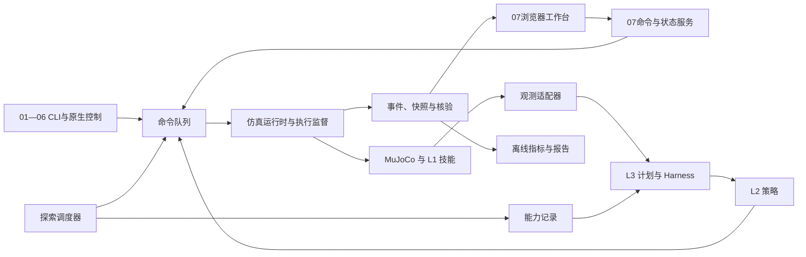

# 00 总实施路线图与技术决策

| 属性 | 内容 |
|---|---|
| 版本与日期 | V0.2 · 2026-11-16 |
| 状态 | 实施设计草案，供项目负责人评审 |
| 上位需求 | [Cross-Embodiment Decision Lab PRD V1.2](../../Cross_Embodiment_Decision_Lab_PRD_v1.1.md) |
| 目标 | 在八周时间预算内完成两种机器人、能力探索、分层决策与可信评测，形成可讲解的求职项目 |
| 当前证据 | 01 已有物理任务与验收记录，完整 playground 经用户决定后移。当前状态以代码、锁文件、验收证据及本文件第 8 节为准 |

## 1. 阅读与实施顺序

先阅读本文件的架构和时间表，再按下表实施。每份文档包含基础知识、接口、操作步骤、验收、故障定位和理解练习。文档中的命令、目录与接口均为待实现的交付约定，其可运行状态随阶段验收更新。

| 顺序 | 文档 | 完成时的可运行成果 | PRD 阶段 |
|---|---|---|---|
| 01 | [单机械臂物理任务与调试基础](01_单机械臂物理任务与基础工作台.md) | CLI/原生查看器运行抓取、放置与失败，保存可重建证据 | M1 基础 |
| 02 | [分层决策与完整任务闭环](02_分层决策与完整任务闭环.md) | CLI 自然语言任务通过规则或模型执行，计划与决策可检索 | M1 主体 |
| 03 | [动态干预、异常恢复与事件回放](03_动态干预异常恢复与事件回放.md) | 三类干预、恢复、重规划、记录重建与基础成对实验 | M1 验收 |
| 04 | [自主探索与能力边界建模](04_自主探索与能力边界建模.md) | 多条件探索形成能力证据并影响在线决策 | M2 |
| 05 | [第二形态机器人与共享机制验证](05_第二形态机器人与共享机制验证.md) | 移动搬运场景与跨机器人共通决策 | M3 |
| 06 | [对照实验与结果分析](06_对照实验与结果分析.md) | 批量对照、未见条件、统计与报告 | M4 研究 |
| 07 | [系统联调与最终交付](07_系统联调与最终交付.md) | 在真实 benchmark 接口上实现 playground，完成两场景展示与一致性回归 | M4 交付 |

文档 00 对应 M0。用户对技术方案的评审沿用 PRD 第 10 章要求。评审可以一次覆盖整套方案，实施期间的常规调试和参数选择沿既定边界推进。

## 2. 时间预算与范围

### 2.1 八周安排

按已有基本 Python 编程能力、每周约 20—30 小时可投入时间安排，参考总预算为 200 小时，包含学习、实现、实验和修复。Agent 可以承担代码和资料整理，项目负责人仍需要阅读关键路径、运行实验和解释结果。实际进度通过每周完成证据校准。

| 周次 | 文档 | 参考工时 | 周末检查点 |
|---|---|---|---|
| 第 1 周 | 00 与 01 | 6 + 24 小时 | 物理任务、原生观察、CLI、独立核验、记录和可靠性 |
| 第 2 周 | 02 | 26 小时 | 规则与模型的同一闭环，计划与候选可检索 |
| 第 3 周 | 03 | 24 小时 | 三种扰动、故障注入、状态重建与成对运行，M1 验收 |
| 第 4 周 | 04 | 26 小时 | 同预算探索、能力版本、静态能力图和在线使用 |
| 第 5 周 | 05 | 28 小时 | 第二场景 CLI/原生路径，共通问题与适配证据 |
| 第 6 周 | 06 | 26 小时 | 实测报告、数据契约、存量读取与结果重建 |
| 第 7—8 周 | 07 | 40 小时 | playground 接入、A04/G04、回归与求职交付 |

以上为重新分配后的规划预算，合计 200 小时。01 的实际已投入工时在阶段收尾记录中填写，后续排期以实际余量校准。

01 收尾优先核对已有物理任务、环境锁定、状态记录和可靠性证据。02—06 继续通过原生查看器、CLI 和静态图表定位问题，07 接入浏览器。接触、观测、核验和记录问题在发现阶段修复。涉及范围调整时按用户已确认的目标记录影响和决定。

第 3 周、第 5 周检查实际耗时与剩余量。偏差超过一个工作周时，将问题、已完成证据和八周内可交付边界列清楚。第 8 周按真实完成状态结算项目，尚未达成的 FR 保留为未完成项。

### 2.2 本次建议的具体场景

- 场景 A 使用 Panda 七轴机械臂和夹爪，完成桌面物体搬运，支持目标移动、路径障碍和抓取滑落。
- 场景 B 使用简洁的双轮差速搬运底盘，完成载货到点，支持临时障碍、通道封闭和目标变更。底盘、驱动轮与货物参与动力学和碰撞。
- 自主探索以机械臂抓取的二维条件空间为主，优先使用物体平面位置与接近角度中的两项。移动机器人复用探索流程，验证通道余量或转向速度的一维能力。
- L2 比较规则、低延迟模型和通用模型。第 2 周先接通一种模型，第 6 周形成三者的实测比较。模型名称按可用接口和试测结果登记。
- 01—06 共用 CLI、原生观察和独立实验核心，完整 playground 在 07 接入真实 benchmark 结果与命令入口。每次运行保留事件、状态、配置和物理结果。

## 3. 技术决策与替代路径

### 3.1 本机与依赖

2026-11-15 只读检查得到以下环境。

| 项目 | 已观察值 | 对方案的影响 |
|---|---|---|
| CPU | Intel i5-12450H，12 逻辑处理器 | 先采用单环境 CPU 仿真，批量并发按实测开放 |
| 内存 | 约 15.8 GiB | 同时加载一个主场景，限制快照缓存大小 |
| GPU | RTX 3060 Laptop，6144 MiB | 支持浏览器显示，模型接口优先使用已有服务 |
| 系统默认 Python | 初次检查为 3.8.10 | 项目使用 uv 管理的独立解释器 |
| 01 项目环境 | 验收记录为 Python 3.12.10、MuJoCo 4.0.1、NumPy 2.5.4 | 复用 pyproject.toml、uv.lock 与实际验收环境，新增依赖按任务记录 |
| 已有工具 | uv 0.10.9，Node 24.15.0，Git | 可进行环境管理、前端构建和版本记录 |

| 决策 | 首选实现 | 选择依据 | 风险与替代 |
|---|---|---|---|
| 物理引擎 | 当前实现使用 MuJoCo 4.0.1、Python 3.12.10 | 01 已有加载、接触、搬运与可靠性证据 | 变更版本时更新锁文件并验证模型、状态重建与旧场景 |
| 机械臂资产 | Menagerie 的 franka_emika_panda，固定提交 | 提供 MJCF、位置执行器、夹爪模型及资产来源 | 检查模型版本与许可证，必要时采用同项目兼容提交 |
| 末端控制 | MuJoCo Jacobian 的阻尼最小二乘 IK，复用模型位置执行器 | 有限桌面任务中便于阅读和定位误差 | 加入姿态误差、关节限位与路径碰撞检查，收敛不足时评估 mink 的现成 IK |
| 第二机器人 | 小型差速底盘 MJCF、速度执行器、标准差速控制 | 几何与动力学可解释，任务需要的自由度较少 | 校准轮轴、接触、惯量和速度环，成熟公开底盘可作为替换候选 |
| 观察与最终工作台 | 01—06 使用 MuJoCo 原生查看器与 CLI，07 建议 Vite、TypeScript、Three.js | 先依据真实实验验证数据和命令语义，再实现集成显示 | 07 验证资产转换、坐标映射及 benchmark 一致性 |
| 本地服务 | 07 按实际接口接入 FastAPI、WebSocket，02 建立数据校验契约 | CLI、批量与浏览器共用实验核心 | 服务单实例，命令经运行时审核，指标读取评测产物 |
| 模型调用 | 一个异步适配器接现有模型 HTTP API | 两层规划共享接入逻辑，模型配置可替换 | 测试超时、结构化输出、配额与费用，连接失败时运行规则对照 |
| 实验存储 | 每运行一个目录，JSON 配置、JSONL 事件与快照、CSV 汇总 | 可手动检查、复制与复现 | 顺序写入、终态清单、恢复扫描和原子替换 |
| 统计 | NumPy、SciPy，报告图使用 Matplotlib | 具备成熟统计与绘图能力 | 样本不足时呈现区间和探索性结论 |

初稿的 Python 3.11 / MuJoCo 3.3.7 选型已由 01 实施采用的 Python 3.12.10 / MuJoCo 4.0.1 组合接续。当前依赖以 pyproject.toml、uv.lock 和实际运行记录核对。前端依赖在 07 首次安装验证后固定版本。模型费用由调用数量、输入输出 token 和供应商价格计算，试跑十个回合后估计完整预算，由用户决定付费额度。

## 4. 系统如何运行



### 4.1 状态归属与并发

- 仿真线程持有唯一的 MuJoCo `MjModel`、`MjData`、当前技能、任务状态和有效计划版本。所有改变世界的操作通过命令队列进入，固定步边界应用。
- CLI 和原生控制使用同一核心命令处理。07 的 API 负责协议校验与排队，运行时返回 `command_id` 对应的接受、拒绝和执行结果，UI 根据回执显示。
- 规划和模型请求使用不可变观测快照。响应携带 `run_id`、`epoch`、计划版本、观测编号与候选集合哈希，执行监督在应用前复查。
- 复位或切换场景递增 `epoch`，取消旧任务并终结旧运行。晚到响应记录为过期。重复 `command_id` 返回原回执。
- 初始物理步长 0.002 秒，控制目标更新约 50 Hz，观测约 10 Hz，状态快照约 20 Hz；07 浏览器消费已有快照。L2 在技能边界、重要变化或异常时触发。慢模型等待期间保持受监督的控制，必要时停在可维持的姿态。
- 07 服务启动使用单 worker。批量评测先串行，每个回合独立复位，后续并行需要独立进程和独立输出目录。

### 4.2 三类数据的使用

| 数据 | 使用者 | 具体内容 |
|---|---|---|
| 机器人观测 | L3、L2、Harness、任务状态估计 | 可见对象估计、观测时间、噪声、置信度、关节和可测执行反馈 |
| 仿真核验数据 | 成功检测、碰撞核验、探索标注、评测 | 真实位姿、接触、速度、场景参数与终态 |
| 显示与重建快照 | 原生观察、状态重建，07 浏览器与回放 | 仿真几何位姿、相机、事件标记 |

01 的输入为明确标注的仿真精确位姿。02 将观测演进为明确标注的 `simulated_state_sensor`。它按相机视野、射线遮挡、采样周期和噪声生成对象观测，身份识别依赖场景标注。报告说明这一感知假设。隐藏对象的最新位姿只出现在核验和显示快照中，历史观测保留最后可见时间。

### 4.3 建议的最小源码结构

```text
src/decision_lab/
  app.py                 07 服务适配入口
  runtime.py             后续共享运行状态、队列与固定步进
  contracts.py           观测、计划、决策、能力与事件契约
  simulation/            场景、观测传感器与物理核验
  robots/                Panda 与移动底盘的专用控制、技能和约束
  planning.py            L3 与计划校验
  harness.py             候选构造与过滤记录
  policies/              规则与模型 L2
  supervisor.py          动作审核、预算、取消与升级
  exploration.py         实验选点与能力更新
  recording.py           现有 RunRecorder，运行目录、事件与 states.jsonl
  evaluation.py          批量执行、指标与报告
  __main__.py            CLI
web/src/                 07 建立 Three.js 场景与工作台
configs/                 场景、任务、探索、评测配置
assets/                  固定版本模型、网格与许可证
tests/                   PRD 要求的契约、故障与场景回归
runs/                    按 run_id 保存的运行数据
```

现有 __main__.py、runner.py、reach.py、grasp.py、pick_place.py 和原生 viewer 已构成 01 运行入口。上表的后续模块按职责演进，读取现有调用链后复用合适实现。第 5 周以第二机器人验证边界，公共函数只接收标准观测、能力和语义动作。相同业务字段以 `contracts.py` 为权威定义，前端类型由其 schema 派生或执行一致性检查。

## 5. 每阶段的共同工作方式与任务结束交付

### 5.1 工程循环与依据

每个有独立验收意义的任务按“需求与验收 → 必要设计/原型 → 小步变更 → 测试与实际运行 → 审查 → 回归与交接”推进。一次变更以便于阅读和验证为尺度。同一任务的修复继续更新原记录。

ROS 2 的开发指南描述任务、设计评审、实现、审查和 CI；Isaac Lab 使用聚焦 PR、测试与 Agent 任务证据；REP-2004 提供版本、变更、文档和测试维度；NeurIPS Checklist 支持实验复现与结论边界。本文模板、目录和练习是本项目针对个人学习的裁剪。[ROS 2](https://github.com/ros2/ros2_documentation/blob/rolling/source/The-ROS2-Project/Contributing/Developer-Guide.rst)、[Isaac Lab](https://isaac-sim.github.io/IsaacLab/main/source/refs/contributing.html)、[REP-2004](https://github.com/ros-infrastructure/rep/blob/master/rep-2004.rst)、[NeurIPS Checklist](https://neurips.cc/public/guides/PaperChecklist)

使用已有任务系统时链接 Issue/PR。个人本地任务可由一份 Markdown 承担任务单和审查记录。2026-11-16 检查显示当前目录尚无 Git 仓库元数据，当前证据使用文件和锁文件哈希。后续先核对正确仓库归属，建立版本管理后记录实际 commit、分支与变更范围。

### 5.2 一份任务记录的六部分

每个任务结束后更新 `docs/engineering/tasks/<task-id>.md`，任务 ID 可采用 `01-收尾核验` 等可读名称。阶段结束更新 `docs/engineering/stages/<阶段号>.md`，链接本阶段任务与原始证据。目录在实际任务产生记录时建立。

| 部分 | 必填内容 | 可核对的输出 |
|---|---|---|
| 1 需求与验收 | 任务目标、关联 FR/测试、起始状态、预期行为、实际完成状态 | 需求 → 改动 → 测试 → 证据映射 |
| 2 技术决定 | 方案依据、主要取舍、关键备选、接口/单位/坐标/时间/状态/格式影响 | 实际决定与受影响调用者，重大决定可链接 ADR |
| 3 变更与审查 | commit 或文件哈希、关键文件与符号、依赖/模型/资产来源、Agent 协助、人工与 AI 审查情况 | 实际差异、发现的问题、处理结果和待审项 |
| 4 验证证据 | 命令/人工操作、日期、解释器、依赖、被测版本、配置/种子、预期、实际、退出码或观察状态、run_id/日志 | 已执行通过/失败、未执行、人工待确认、用户后移分别记录 |
| 5 故障分析 | 最小复现、假设、证据、确认原因、修复与回归 | 一次真实故障的因果链，适用项可说明原因标为不适用 |
| 6 学习与交接 | 实际代码调用链、一个可操作练习、3—5 个问题及核对依据、局限、后续工作 | 操作者能复现、定位、修改并解释本次任务 |

### 5.3 精确的验证与练习格式

验证表每行对应一项检查，使用“检查 ID｜命令或操作｜预期｜实际与状态｜退出码/观察者｜证据路径”。保存实际终端命令、测试数量和失败信息。人工观察填观察者与反馈来源，尚未执行写“人工待确认”。文档任务检查链接、FR/测试映射、阶段依赖和表格。相关代码、依赖或配置变化后重新运行受影响检查。

学习练习给出基线命令、要修改的具体参数或故障、单变量控制方式、预期观察、证据位置、恢复原配置的方法。预计操作时间以 10—20 分钟为参考。核对问题应覆盖本次需求、关键机制、失败定位与证据范围，每题提供代码位置、日志或计算方法作为答案依据。操作者执行结果由实际反馈更新。

阶段交接表汇总验收状态、原始记录、有效版本、技术假设、用户后移事项和下一阶段入口。01 的 A04 明确关联 07 的补验位置。复用现有日志、README 和实验报告，任务记录通过链接组织证据。

### 5.4 Playground 的接入条件与一致性

07 开始时检查 F01、F02、F07 的实际结果，确认核心能独立运行真实任务与成对实验，成功和失败记录完整，指标能从原始数据重建。效果方向由数据决定。记录 schema、单位、时钟、状态、运行身份和生效配置均有版本。

现有记录为 `manifest.json`、`events.jsonl`、`states.jsonl`、`telemetry.csv`、`summary.json`，并包含 `record_schema_version`、`model.mjb` 与依赖哈希。02—06 在实际需求下演进，声明新增字段、读取默认值、兼容范围和迁移规则。核验数据、模型观测和最终 UI 显示数据保持各自明确权限。

G04 检查四项内容。第一，至少读取 01 与 06 的真实成功/失败记录。第二，同一原始 run 的 CLI 报告与 UI 汇总在统一单位、舍入规则下吻合。第三，UI 命令通过相同运行时和监督入口。第四，接入后运行既有 headless 回归，现场重执行按声明的数值容差和模型非确定性解释差异。

## 6. PRD 全量映射

下表的文档编号同时关联第 2 节的工时预算。每条需求的成本计入主责阶段，共用组件的开发量按阶段合计。表中测试名在各实施文档中定义。

| FR | 主责文档 | 实现与验收证据 | 主要风险与处理路径 |
|---|---|---|---|
| FR-001 | 01 | A01 物理接触、参数变化、掉落 | 接触不稳，校准模型与步长 |
| FR-002 | 01、02 | A02 完整搬运，B01 任务终态 | 假完成，独立物理核验 |
| FR-003 | 03 | C01—C03 三种干预与控制回执 | 时机漂移，步编号和事件触发 |
| FR-004 | 01、06 | A03 复位，F01 配对初始清单 | 种子不足，保存完整配置与状态 |
| FR-005 | 05 | E01 场景切换与运行 | 残留状态，epoch 和场景清单 |
| FR-006 | 02 | B02 任务解析及不可执行目标 | 幻觉对象，schema 和对象校验 |
| FR-007 | 02 | B01 计划步骤和版本时间线 | 进度失真，运行时事件驱动 |
| FR-008 | 02 | B03 遮挡、过期与缺测 | 真值泄露，字段白名单与等价输入测试 |
| FR-009 | 03 | C03 目标失效后的计划修订 | 重规划循环，预算和原因去重 |
| FR-010 | 02 | B04 档案与专用约束检查 | 混入专用逻辑，档案契约 |
| FR-011 | 02、04 | B04 人工来源，D03 能力证据 | 来源失真，证据链接与状态规则 |
| FR-012 | 02、05 | B05 同候选输入，E02 跨形态请求 | 筛选替代模型，保留过滤前后清单 |
| FR-013 | 02 | B06 越界和未知条件 | 误拒绝，区分未知与已知违规 |
| FR-014 | 04 | D03 失效、复核与版本 | 旧结果覆盖新版本，条件提交 |
| FR-015 | 02、06 | B05 策略替换，F02 三策略比较 | 底层变化混淆，冻结公共配置 |
| FR-016 | 02 | B05 决策、延迟与结果链 | 自述分数误用，单独标明分数来源 |
| FR-017 | 01、02 | A02、B01 真实结果与中断 | 物理结果误报，持续稳定窗口 |
| FR-018 | 02、03 | B06 约束，C04 故障与中止 | 停止延迟，仿真线程独立执行监督 |
| FR-019 | 03 | C01—C03 分级恢复路径 | 失败分类模糊，明确触发与终态 |
| FR-020 | 03 | C04 重试、升级、超时上限 | 无效循环，签名计数与墙钟超时 |
| FR-021 | 04 | D01 可执行实验及成功定义 | 实验不可辨识，固定其余条件 |
| FR-022 | 04 | D02 同预算主动/随机选点 | 预算不公平，按真实试次数核算 |
| FR-023 | 04、06 | D03 区间，F04 未见条件验证 | 小样本过度结论，保留未知 |
| FR-024 | 04 | D04 能力更新前后成对任务 | 任务同时变化，冻结其他配置 |
| FR-025 | 05 | E01 差速动力学与独立搬运任务 | 轮胎打滑，实测控制与载货稳定 |
| FR-026 | 05 | E02 公共流程和代码修改清单 | 分支蔓延，专用适配与共享接口审查 |
| FR-027 | 05、06 | E03 共通问题，F05 适配对照 | 跨任务混比，分别报告本体性能 |
| FR-028 | 07 | A04 浏览器观察，G01 使用，G04 数据接入 | 接入契约漂移，先验收真实 benchmark 接口 |
| FR-029 | 02、03、07 | B05/C05 结构化解释，G01 浏览器详情 | 双重状态，消费已有决策与事件 |
| FR-030 | 03 | C05 完整时间线及关联 ID | 事件丢失，连续序号和终态检查 |
| FR-031 | 03、07 | C05 状态重建，G02 回放完整性 | 记录缺口，标记缺失与失败片段 |
| FR-032 | 03、06、07 | C06/F01 命令与报告，G04 界面一致性 | 条件漂移，共用初始清单和结果来源 |
| FR-033 | 05、07 | E01 两条路径，G01 评审者体验 | 展示依赖作者，内置任务与操作指引 |
| FR-034 | 01、07 | 01 原生调试可读，07 A04/G01 完整体验 | 资产与性能冲突，基于实测调整 |
| FR-035 | 01、06 | A03 运行清单，F01 版本哈希 | 配置遗漏，导出实际生效值 |
| FR-036 | 02、06 | B05 规则基线，F02 同条件比较 | 基线偏弱，固定合理规则并报告规则 |
| FR-037 | 03、06 | C06 基础指标，F01 完整统计 | 分母错误，终态和缺失值规则 |
| FR-038 | 02、06 | B03 信息隔离，F06 候选贡献审计 | 提示词暗含答案，等价观测与候选审计 |
| FR-039 | 06 | F04 冻结测试集与失败清单 | 调参污染，开发与测试清单分离 |
| FR-040 | 06、07 | F07 导出报告，G03 交付检查 | 结论超范围，逐条附证据与局限 |

## 7. 参考项目与学习材料

| 参考内容 | 本项目的使用方式 | 实施验证 |
|---|---|---|
| robo-jev method 的三层职责与结构化问题 | 借鉴事件驱动判断、候选选择和模型版本记录 | 文档 02 的 B05 |
| pointworld 的观测表达与隔离思想 | 建立观测、核验、显示三条数据路径 | 文档 02 的 B03 |
| model_policy 与 delegation 的可替换策略、执行边界 | 统一策略输入输出，控制器专用化 | 文档 02、05 的替换检查 |
| closed_loop 的成对实验思想 | 固定场景、控制器和扰动，分别评价决策与闭环结果 | 文档 06 的 F01、F02 |
| results 的泛化与偏差分析 | 加入未见条件、候选顺序和失败分析 | 文档 06 的 F04、F06 |

本次核对了来源项目的 method、docs 索引和 results。源码级接口、许可和固定提交在相关模块实施时逐个检查，复用范围写入来源记录。来源项目 docs 索引明确标注 2026-10-11 起的数据生成路线及此前的桌面闭环归档。本项目使用自身的运行时、两条物理场景和评测定义。

- MuJoCo Python 安装、状态和 viewer。 [官方文档](https://mujoco.readthedocs.io/en/stable/python.html)
- 当前锁定的 MuJoCo 包信息。 [PyPI](https://pypi.org/project/mujoco/4.0.1/)
- Panda 模型、执行器和 Apache-2.0 许可证。 [模型说明](https://github.com/google-deepmind/mujoco_menagerie/tree/main/franka_emika_panda)
- Three.js 场景、相机、网格与变换。 [官方手册](https://threejs.org/manual/)
- FastAPI WebSocket 通信。 [官方文档](https://fastapi.tiangolo.com/advanced/websockets/)
- 三层决策与结构化判断。 [robo-jev method](https://github.com/STEERIX-home/robo-jev/blob/main/docs/method.md)
- 研究路线与历史状态。 [robo-jev docs](https://github.com/STEERIX-home/robo-jev/blob/main/docs/README.md)
- 模型结果、失败和外部验证。 [robo-jev results](https://github.com/STEERIX-home/robo-jev/blob/main/docs/results.md)

## 8. 本阶段验收与个人理解

- [ ] 能按一次具体任务画出观测、规划、候选、判断、执行和核验的数据流。
- [ ] 能指出物理状态、计划状态、能力版本的权威保存位置。
- [ ] 理解八周预算依赖投入时间、现成资产和第一周原型结果。
- [ ] 能解释选择当前技术栈的原因及至少一条替代路径。
- [ ] 完成方案评审，记录调整决定后进入文档 01。

### 01 收尾的当前证据

2026-11-16 读取 `runs/stage01_acceptance/20261115T164152_310100Z/acceptance.json`，其 scope 为 `stage_01_physical_foundation_A01_A03`，A01、A02、A03 和 regression 标为通过，A04 标为 `deferred_by_user`。文件汇总 19 个 run、6,316 个状态记录及状态重建结果。本次为既有证据核读，运行是否重验由实际任务记录说明。此前各进度段落按其记录日期理解。

文档中的阈值作为可追溯设计值，实际调整保存配置版本、原因和受影响实验。00 本身完成修订后，也按第 5 节提交设计与文档验证记录。

## 9. 00 任务结束后的具体交付

执行总方案或路线调整任务后，提交六部分记录，并附以下针对本阶段的材料。

- 一张更新后的 FR—阶段—测试追溯表，标出需求决定及用户授权来源。
- 一份实际架构与依赖说明，区分已有实现、后续建议和待验证假设，引用代码/锁文件/运行记录。
- 一张范围与预算变化表，写明 playground 接入条件、A04 后移和实际余量。
- 验证结果包含九份文件的本地链接、代码块、需求与测试编号、工时合计和阶段依赖检查。
- 学习练习要求操作者选择一个 run，从 manifest 找到配置/环境，再沿代码指出状态、控制、核验与记录的归属。核对问题覆盖模块职责、证据来源、阶段后移理由和接口一致性。
