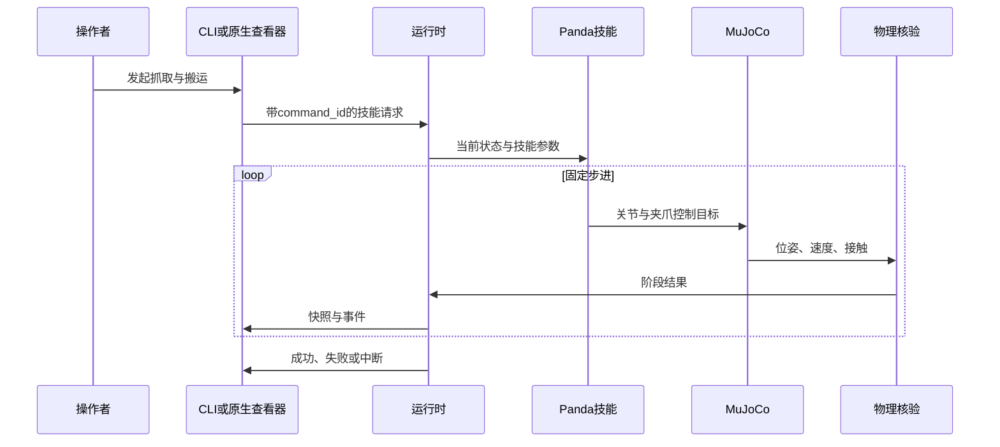

# 01 单机械臂物理任务与调试基础

| 属性 | 内容 |
|---|---|
| 版本与状态 | V0.2 · 2026-11-16 · 物理基础收尾，按实际证据验收 |
| 前置阅读 | [00 总实施路线图](00_总实施路线图与技术决策.md) |
| 时间预算 | 第 1 周，约 24 小时 |
| 主要需求 | FR-001、002、004、017、034基础、035；FR-028 与 A04 在 07 接入 |
| 完成体验 | CLI/原生查看器运行抓取、搬运、放置，检查物理结果、复位与记录重建 |

## 1. 要解决的问题

建立可重复运行的物理任务，先把动作与结果之间的关系看清楚。目标物体有自由运动状态，夹爪通过接触和摩擦提起物体，放开后物体受重力和支撑影响。

本阶段的完整路径是加载 → 接近 → 闭合 → 抬升 → 搬运 → 放置 → 松开 → 验证 → 终态。原生查看器与 CLI 反馈当前技能、阶段和核验结果。完整 playground 在 07 根据真实 benchmark 接口集成，01 收尾检查 A01—A03 与可靠性回归。

## 2. 需要掌握的基础

| 概念 | 在项目中的位置 | 亲手验证的方法 |
|---|---|---|
| 世界、机器人基座与末端坐标系 | 目标位置换算与夹爪姿态 | 绘制三组坐标轴，沿世界 X 轴移动目标 |
| 位姿 | 位置和朝向共同决定抓取 | 固定位置，改变末端绕竖直轴的角度 |
| 正运动学 FK | 从关节角得到末端位姿 | 改一个关节角，观察末端运动 |
| 逆运动学 IK | 从目标位姿计算关节目标 | 比较目标与实际末端误差 |
| Jacobian 与阻尼 | 将末端误差映射到关节变化，缓解奇异附近的大步长 | 比较不同阻尼下的收敛与速度 |
| 位置执行器 | 用关节目标产生有限驱动力 | 降低力限，观察实际位置跟随误差 |
| 接触与摩擦 | 决定物体是否被夹住、滑落 | 固定姿态改变摩擦并重复抓取 |
| 固定步长 | 保持积分和控制时间语义一致 | 检查仿真时间与步编号 |

统一米、千克、秒和弧度。MuJoCo 四元数通常采用 `wxyz`，Three.js 使用 `xyzw`。对外契约明确使用 `xyzw`，适配器负责顺序转换。01 记录约定与原生观察一致，07 接入 Three.js 时按同一 Z 向上和四元数顺序校验转换。

## 3. 场景与物理判定

### 3.1 初始场景

固定基座 Panda、桌面、一个约 4 cm 的方块、目标托盘和一个禁触物体。机器人基座到方块的平面距离先在约 0.35—0.55 m 的可达区域试测。方块初始质量约 0.08 kg，摩擦、桌面高度和夹爪力限写入场景配置，实测后固定。

原生场景提供可辨认的机器人、桌面、物体、目标区域和默认斜俯视角，支持必要的夹爪聚焦与总览。07 再集成浏览器场景与交互布局。

### 3.2 初始成功条件

| 结果 | 核验方式 |
|---|---|
| 抓取成立 | 指尖与物体存在有效接触，物体被抬离桌面至少 5 cm，并在 0.5 秒窗口保持相对夹爪稳定 |
| 放置成功 | 方块位于目标区域内，桌面或托盘提供支撑，线速度低于 0.02 m/s，夹爪已松开并撤离，条件连续成立 0.5 秒 |
| 约束失败 | 禁触物体与机器人或搬运物体出现配置定义的有效接触 |
| 抓取失败 | 闭合后未形成有效持物状态，或搬运中掉落 |
| 执行超时 | 技能在指定仿真时间内未达目标，且墙钟看门狗也能发现线程停滞 |

这些值是初始阈值，实施时根据模型尺度和接触噪声校准。核验模块直接读取物理状态，在线策略通过受控的执行反馈获得可测持物信息。每个结论保存判定配置版本。

## 4. 控制和显示的数据流



仿真线程为物理状态的唯一写入者。调试复位可以设置初始 `qpos`，正常动作通过 `data.ctrl` 和执行器驱动物理运动。执行过程中记录物体是否存在附着约束，抓取验收检查接触驱动的持物过程。

## 5. 实施步骤

### 步骤 1 建立隔离环境与模型加载，约 3 小时

当前 pyproject.toml 与 uv.lock 已采用 Python 3.12、MuJoCo 4.0.1 和 NumPy 2.5.4。使用已锁定环境核对实际解释器和包版本，并将结果写入收尾记录。

```powershell
uv sync --locked
uv run python -c "import sys, mujoco, numpy; print(sys.version); print(mujoco.__version__); print(numpy.__version__)"
```

获取固定提交的 Panda 模型及其所引用的全部资产，保留 LICENSE 与来源说明。在最小场景中运行 1,000 个物理步，检查状态为有限数值。第一周把实际 Menagerie 提交、Python 补丁版本和各依赖版本写入运行清单。

### 步骤 2 实现末端到位与夹爪控制，约 5 小时

1. 从模型名称解析关节、执行器和末端 site ID，启动时检查完整性。
2. 使用 `mj_jacSite` 构造末端 Jacobian，限定机械臂关节列，计算位置与朝向误差。
3. 用阻尼最小二乘计算小步关节增量，约束关节范围和每步变化率。
4. 在独立的规划状态上求解目标，执行时向现有位置执行器发送平滑目标。
5. 记录 IK 残差、收敛状态、跟随误差与控制超时。

首先验证三个静态末端目标，再进行接触。对路径插值采样做机器人与场景碰撞检查，记录采样分辨率和检查范围。连续执行仍由监督器检查接触与硬约束。

### 步骤 3 组合完整技能，约 6 小时

把接近、下降、闭合、验证、抬升、搬运、下降、松开、撤离组成可中断状态机。每个阶段有进入条件、控制目标、成功条件和超时。

桌面路径使用经过验证的预抓取与抬升航点。路径参数从观测目标计算，障碍变化触发重验。保留两种有意义的候选，例如不同接近角度或搬运侧向航点。障碍超出当前路径能力时返回明确失败原因，由上层决定后续动作。

### 步骤 4 调试入口、状态记录与可靠性，约 6 小时

- 复用现有 CLI 与 MuJoCo 原生 viewer，核对暂停、取消、复位、聚焦和终态反馈。
- headless 与原生运行共用物理任务、成功判定和记录器，检查正常、空抓、障碍、滑落与超时。
- 保存 manifest、events、states、telemetry 和 summary，记录 schema、单位、四元数顺序、依赖锁哈希与模型身份。
- 检查状态重建、失败记录、看门狗和中断收尾，明确实际验证范围。
- 完整浏览器 A04 已按用户决定转交 07，接入时复用本阶段的真实模型与记录。

### 步骤 5 复位、记录与验证，约 4 小时

每次运行保存实际初始位姿、质量、摩擦、控制器参数、步长、随机种子、资产哈希和判定规则。复位重建或完整恢复模型状态，清理控制、接触历史和技能计时。重复运行比较初始快照及结果。

## 6. 接口与阅读路径

```json
{
  "command_id": "cmd-001",
  "run_id": "run-a01",
  "epoch": 1,
  "type": "execute_skill",
  "skill": "pick_place",
  "parameters": {
    "object_id": "cube_red",
    "target_region": "tray_a"
  }
}
```

运行时回执包含 `accepted`、`reason` 和 `execution_id`。快照包含 `run_id`、`epoch`、`step`、`sim_time_s`、body 位姿/可重建的模型状态和当前阶段，结果包含终态、原因码和核验窗口。

当前阅读顺序为 `__main__.py` → `watchdog.py` / `runner.py` → `pick_place.py` → `robots/panda_pick_place.py` 与 `robots/panda.py` → `simulation/placement.py` / `verification.py` → `recording.py`；原生观察入口为 `pick_place_viewer.py`。后续 runtime 和服务适配按实际需求演进。

## 7. 验收清单

| 测试 | 操作 | 通过证据 |
|---|---|---|
| A01 | 改变质量或摩擦，运行抓取与掉落试验 | 物理轨迹和结果确实变化，参数与快照完整 |
| A02 | 运行完整搬运，包含成功、空抓和掉落 | 物理核验给出准确终态，时间线保留失败 |
| A03 | 同配置复位三次，再改变种子 | 初始状态可比较，模型、控制器和参数版本可导出 |
| A04 | 用户后移至 07 的浏览器观察与操作 | 07 补验 Panda/物体同步、命令回执、异常恢复；01 交接记录为 deferred_by_user |

基础固定场景先做 10 次试跑，目标为至少 8 次成功，以检查底层技能是否足以支撑后续决策研究。该值作为项目内部控制质量检查，正式成功率在独立测试集报告。持续偏低时记录失败类别并修复控制路径。

## 8. 故障定位

| 现象 | 优先检查 | 可验证的修复 |
|---|---|---|
| 末端方向错误 | 坐标轴、四元数顺序、site 定义 | 画坐标轴并执行已知姿态 |
| IK 抖动 | 单步增量、阻尼、姿态误差、关节范围 | 固定目标比较残差曲线 |
| 方块穿透或弹飞 | 初始重叠、惯量、步长、接触参数 | 单方块落桌试验 |
| 夹爪闭合却空抓 | 方块宽度、夹爪中心、闭合时机 | 慢速侧视并显示接触点 |
| 原生显示与记录重建偏移 | 模型身份、坐标顺序、记录时刻 | 同一状态在核验与重建中对照 |
| 复位后结果变化 | 遗留速度、控制量、随机源 | 比较完整初始清单 |

## 9. 学习检查与阶段交接

亲自修改方块位置，解释目标坐标如何变成关节目标。降低夹爪可用力，保存一次滑落记录，解释核验为何判定失败。选择一条 states.jsonl 记录，核对重建位姿与运行时快照。

交接内容包含可运行场景、控制与核验代码、CLI/原生观察、A01—A03 与可靠性记录、A04 后移依据、来源许可与实际性能。文档 02 将复用这些技能，并通过观测对象引用构造任务动作。

- 位姿、动力学和数据字段。 [MuJoCo 概览](https://mujoco.readthedocs.io/en/stable/overview.html)
- Jacobian、步进与状态计算。 [MuJoCo API](https://mujoco.readthedocs.io/en/stable/APIreference/APIfunctions.html)
- Panda 的执行器与夹爪定义。 [模型源码](https://github.com/google-deepmind/mujoco_menagerie/tree/main/franka_emika_panda)

## 10. 2026-11-15 实施进度与学习路径调整

本节保留当时的试验与实现证据，当前验收口径及后续任务以第 11 节的 2026-11-16 修订为准。

项目负责人选择围绕 Panda 搬运任务拆解学习。每个节点同时解释目的、输入输出、涉及技术、失败现象、验证方法与后续复用位置。操作者负责窗口操作和观察，Agent 负责代码、资产准备与技术说明。

当前执行环境为已有的 Python 3.12.10 / MuJoCo 4.0.1。初稿选型为 3.11 / 3.3.7，实际组合采用 3.12.10 / 4.0.1。11 月 15 日该节点的独立环境与锁定待办，已在后续收尾记录中推进，见第 11 节。

官方 Panda 资产位于 `assets/robots/franka_emika_panda/`，固定 Menagerie 提交 `370c43965323c0944b433b202aac5058b5f907a9`，来源与文件哈希见该目录的 `SOURCE.json`，许可证随资产保存。

| 当前节点 | 状态与证据 |
|---|---|
| 官方模型加载与版本固定 | 已完成，73 个来源文件的 SHA-256 已核对 |
| 基础物理步进 | home 姿态运行 1,000 步，状态数值正常 |
| 单关节与夹爪控制检查 | actuator1 目标 0.1 rad 后到达目标附近，夹爪闭合检查通过 |
| 基础离屏渲染 | 320×240 渲染通过 |
| 操作者的交互观察 | 已由操作者确认，各 actuator 可以实时驱动对应运动 |
| 当时的完整阶段验收 | 该节点记录为待实施，当前 A01—A03/A04 状态见第 11 节 |

模型检查详情保存在 `examples/02_panda_inspection/validation.json`。后续依次推进步骤 2 的末端控制、步骤 3 的抓取搬运、步骤 4 的调试与可靠性收尾和步骤 5 的记录验收。

### 三个末端目标原型

步骤 2 的末端控制原型已实现。入口为 `examples/03_panda_reach/open.cmd`，操作与技术说明见同目录 README。

- 复用固定版本官方 Panda，在内存中增加 `grasp_center` 参考点和目标标记。
- IK 使用完整位置与朝向误差、世界参考系 Jacobian、阻尼最小二乘和独立计算状态。
- 关节目标经过限位与路径碰撞检查，再以 50 Hz 更新原位置执行器，物理步长为 0.002 秒。
- 首轮无前馈试跑观察到约 5—6 mm 静态误差。加入经位置执行器生效的偏置力前馈后，三个目标的六种访问顺序均达到核验阈值。
- 18 次到位中的最大稳定位置误差约 0.191 mm，最大朝向误差约 0.081°。结果适用于当前空载场景。
- 8 项回归覆盖状态隔离、四元数符号等价、不可达、碰撞路径、输入校验、实际到位、暂停/取消/复位和超时。
- 原生查看器的启动、文字面板、坐标轴和一次运动已通过短时检查。操作者的本轮按键与观察反馈待完成。

配置位于 `configs/tasks/panda_reach.json`，控制实现位于 `src/decision_lab/robots/panda.py`，运行时与显示分别位于 `reach.py`、`native_viewer.py`。检查摘要见 `examples/03_panda_reach/validation.json`，实际运行记录位于 `runs/panda_reach/`。

下一节点将围绕桌面抓取建立接近、闭合、抬升和物理持物核验，继续推进步骤 3。当时尚待完整搬运、环境锁定和阶段验收，后续进展见本节下文与第 11 节。

### 接触抓取与抬升原型

步骤 3 的接近、下降、闭合、抬升与持物核验已实现。入口为 `examples/04_panda_grasp/open.cmd`，完整技术解释见同目录 README。

- 场景复用官方 Panda，加入 0.20 m 高的桌面和边长 0.04 m、质量 0.08 kg 的自由方块。
- `PandaGrasp` 组织有明确条件和超时的阶段，继续调用同一 `PandaArm`；夹爪命令在抬升期间保持。
- `GraspVerifier` 独立检查双侧接触、最低点离桌高度及相对位姿稳定窗口。
- 碰撞审核显式允许双指与方块接触，机器人与桌面、物体与手掌等非预期接触接受力和穿透审核。
- 物体保留自由关节，新增物体附着约束数为 0，原模型的手指联动约束继续生效。
- 标准、空抓和弱夹持通过相同入口执行，实际物理证据决定结果。
- 长时间持物检查发现默认软接触缓慢滑移，场景采用 5 次 noslip 静摩擦后处理迭代，并加入 30 秒保持回归。
- 零摩擦场景采用一维纯法向接触，以避免为零切向摩擦建立病态约束。
- 桌面场景已增加按键显示、夹爪聚焦、阶段事件、物理指标采样、主动释放和完成后的持物丢失提示。

当前接近输入采用明确标记的仿真精确位姿，技能接口显式接收物体位置。02 的观测适配与信息隔离将在此入口接入。
检查摘要与运行记录索引见 `examples/04_panda_grasp/validation.json`。下一节点继续实现持物搬运、放置与撤离，以及载物路径核验，随后完成调试入口、可靠性与阶段验收。

### 完整搬运与放置原型

步骤 3 的完整物理任务已实现，入口为 `examples/05_panda_pick_place/open.cmd`。
链路包含原抓取技能、载物搬运、放置下降、实际释放、撤离与独立放置核验。

- 载物路径检查使用独立计算状态，按方块相对 TCP 的实测位姿投影物体几何。实际方块继续由接触和摩擦驱动。
- 默认障碍案例中，单独检查机械臂路径通过，包含方块后返回 `collision:cube/path_obstacle`。
- 绕行配置使用相同控制器和判定器，经两个侧向航点通过同一障碍案例，入口为同目录 `detour.cmd`。
- 搬运中降低力限的预设试验产生实际滑移及掉落，参数变化与失败保留在记录中。
- 放置核验覆盖整个物体投影、真实托盘支撑、低速、释放、撤离及 0.5 秒稳定窗口。
- 禁触违规在任务内累计，控制层在任务终态提交前复查物理约束。
- 新任务通过已有运行时的构建入口复用步进、复位、记录与显示，之前的 reach、grasp 入口保留回归检查。

完整代码阅读顺序、场景参数与试验条件见 `examples/05_panda_pick_place/README.md`，检查结果见同目录 `validation.json`。
当前采用显式航点路线和仿真精确位姿输入。后续收尾聚焦环境锁定、步骤 4 的可靠性、步骤 5 的记录与 A01—A03，A04 由 07 补验。


## 11. 2026-11-16 收尾口径与已读取证据

项目负责人决定后移完整 playground。现有 `runs/stage01_acceptance/20261115T164152_310100Z/acceptance.json` 标记 A01、A02、A03 与 regression 通过，A04 为 `deferred_by_user`。该汇总关联 19 个 run、6,316 个状态及重建检查。pyproject.toml 与 uv.lock 已存在，当前环境和模型身份按 manifest 与验收文件核对。

这些为读取既有记录得到的状态，本次文档修订的检查范围为文档一致性。后续执行 Agent 结合实际源码、被测版本和收尾测试决定是否重验，分别记录自动化、原生观察和操作者确认。

## 12. 01 任务结束后的工程记录与学习交付

每个任务按 [00 第 5 节](00_总实施路线图与技术决策.md#5-每阶段的共同工作方式与任务结束交付) 提交六部分“变更与验证记录”。本阶段收尾额外明确以下材料。

| 材料 | 精确内容 |
|---|---|
| 需求与验收映射 | FR-001/002/004/017/034基础/035 对应 A01—A03、可靠性测试和原始 run，A04 写用户后移并链接 07 |
| 技术与审查记录 | IK、接触、载物路径、放置核验、步长、精确位姿输入和固定航点假设，指明实际文件与函数 |
| 验证表 | 实际解释器/包/锁哈希，正常、空抓、弱夹持、障碍、滑落、复位、超时、看门狗、状态重建的命令和结果 |
| 故障复盘 | 从本次确实遇到的故障中选择一例，给出复现、测量、确认原因、修复与回归；沿用旧案例时标明发生节点 |
| 学习材料 | 一张实际调用链，一项单变量质量或夹持力练习，3—5 个含证据答案的问题，覆盖控制、物理核验、版本与记录 |
| 阶段交接 | 当前入口、可用场景、证据版本、精确位姿/航点局限、02 接入位置、A04 的 07 补验位置 |

可执行练习从已通过配置复制一份，先运行基线，再只修改物体质量或夹持力，比较接触、持物、终态与失败原因，恢复原配置后重跑。命令与实际字段以当前 CLI 为准，例如 `uv run python -m decision_lab pick_place --headless --config configs/tasks/panda_pick_place.json`，修改配置使用单独副本。操作者尚未执行时标明人工待确认。
